# ЛР 3. Kubernetes

Локальный кластер Kubernetes на minikube и развёрнутый в нём Nextcloud с базой PostgreSQL. По заданию логин и пароль Postgres вынесены в Secret, переменные Nextcloud вынесены в ConfigMap, у Nextcloud добавлены пробы.

```
браузер --> minikube service --> Service nextcloud (NodePort) --> Pod nextcloud
                                                                     |
                                       POSTGRES_HOST=postgres-service v
                                 Service postgres-service (NodePort) --> Pod postgres
```

| Файл | Объекты | Что это |
|------|---------|---------|
| `pg_configmap.yml` | ConfigMap `postgres-configmap` | имя базы `POSTGRES_DB` |
| `pg_secret.yml` | Secret `postgres-secret` | `POSTGRES_USER`, `POSTGRES_PASSWORD` (новый файл по заданию) |
| `pg_service.yml` | Service `postgres-service` | постоянный адрес базы внутри кластера |
| `pg_deployment.yml` | Deployment `postgres` | сам Postgres, настройки из ConfigMap и Secret |
| `nextcloud.yml` | Secret `nextcloud-secret`, ConfigMap `nextcloud-configmap`, Deployment `nextcloud` | Nextcloud, его настройки и пробы |

Каждый файл подробно прокомментирован внутри. Этот README: ход работы и ответы на вопросы.

## Часть 1. Установка minikube

Работа выполнялась на macOS с Docker Desktop. minikube и kubectl установлены через Homebrew (в методичке пример для Windows с `minikube-installer.exe` и `kubectl.exe`, шаги те же):

```bash
docker version              # Docker Desktop запущен и отвечает
brew install minikube kubectl
minikube version
kubectl version --client
minikube start              # кластер из одного узла в контейнере Docker
docker ps                   # в списке есть контейнер minikube
kubectl config view         # конфиг кластера minikube
```

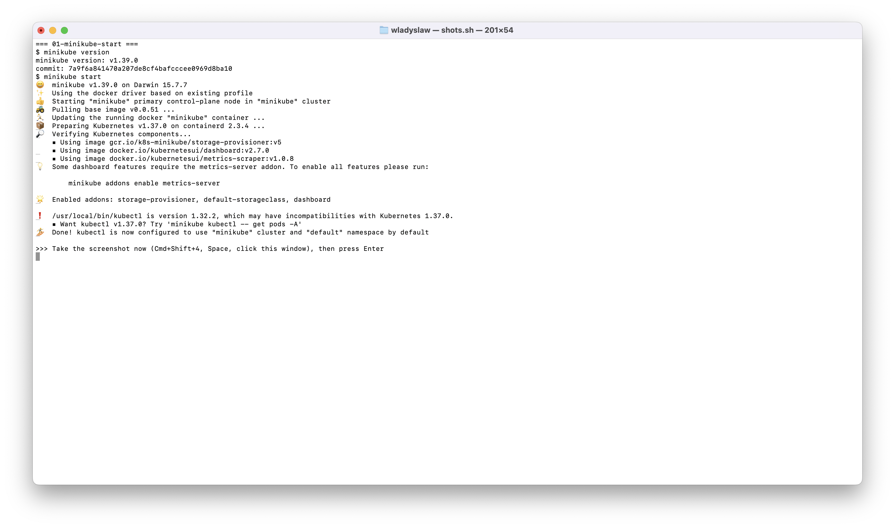

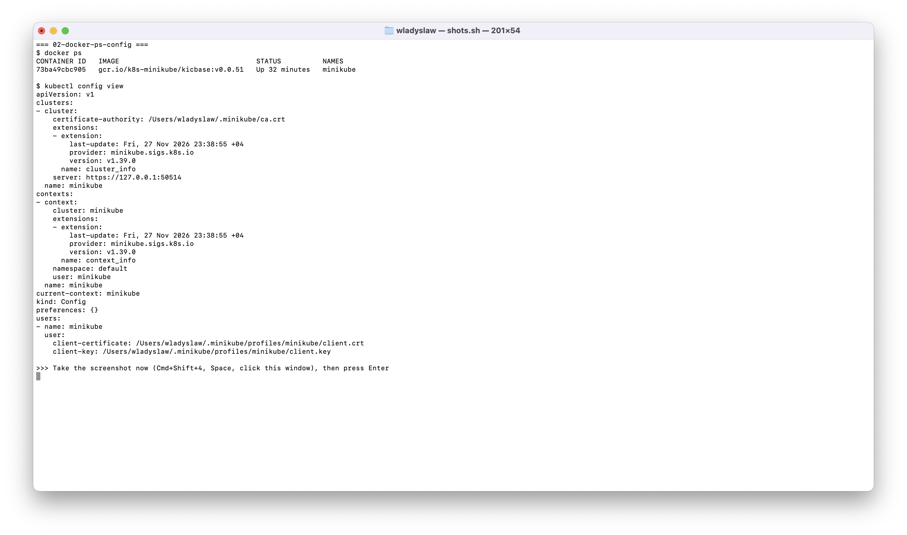

## Часть 2. Создание объектов через CLI

### Postgres

```bash
kubectl create -f pg_configmap.yml
kubectl create -f pg_secret.yml
kubectl create -f pg_service.yml
kubectl create -f pg_deployment.yml
```

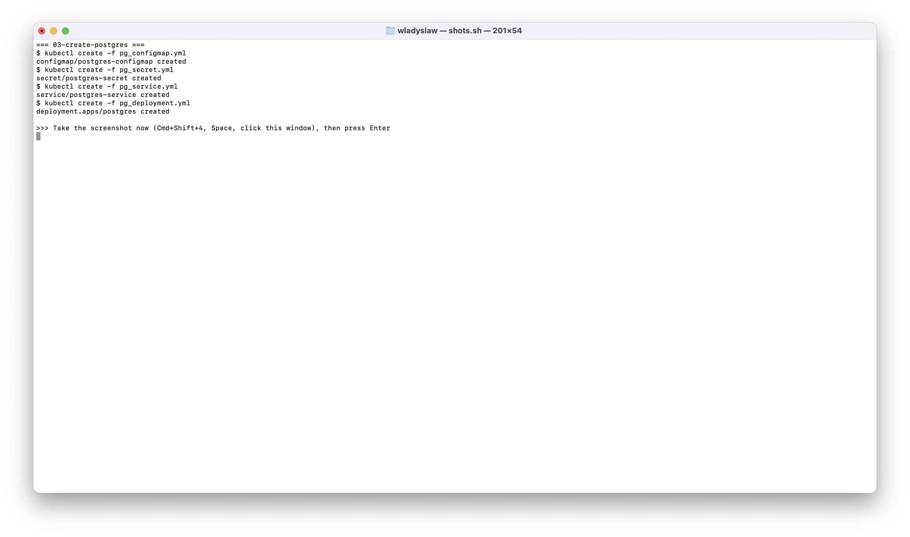

Проверка:

```bash
kubectl get configmap,secret,service,deployment,pods
kubectl describe configmap/postgres-configmap
kubectl describe secret/postgres-secret      # значения скрыты, видны только размеры
kubectl describe deployment/postgres
```

У созданных объектов атрибутов больше, чем в манифестах: манифест задаёт только скелет, остальное (`uid`, `creationTimestamp`, стратегию обновления, `clusterIP`, номер `nodePort` и т.д.) дописывает Kubernetes.

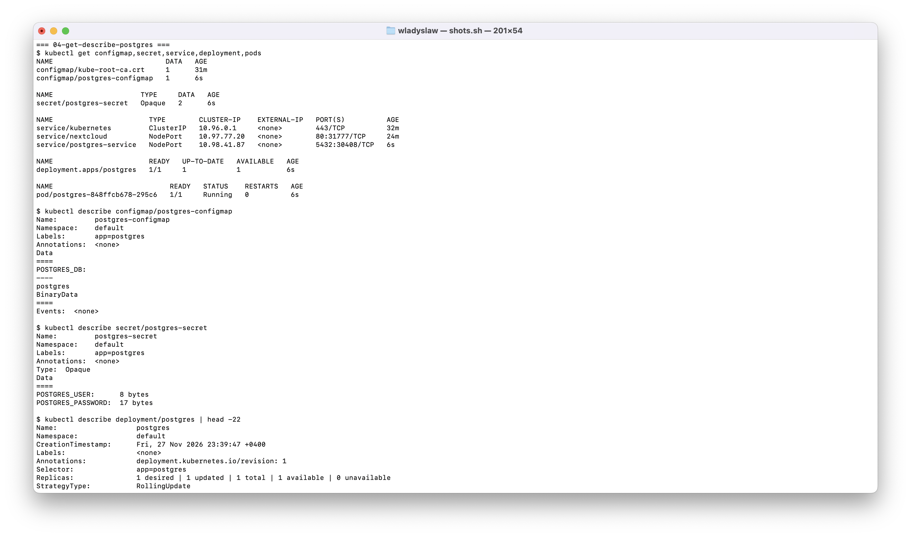

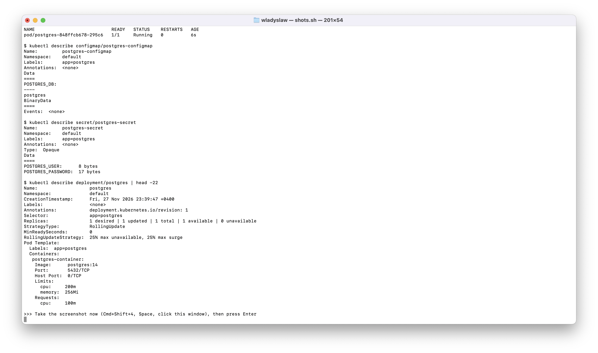

### Nextcloud

Один файл, три объекта через разделитель `---`:

```bash
kubectl create -f nextcloud.yml
kubectl get secret,configmap,deployment,pods
kubectl describe secret/nextcloud-secret     # значение пароля не показывается
kubectl logs -f deployment/nextcloud         # ход установки, Ctrl+C для выхода
```

Установка занимает от полуминуты до нескольких минут. Пока она идёт, под в статусе `Running`, но `READY 0/1`: работает startupProbe. Когда Apache запустился и `/status.php` ответил 200, под становится `1/1`.

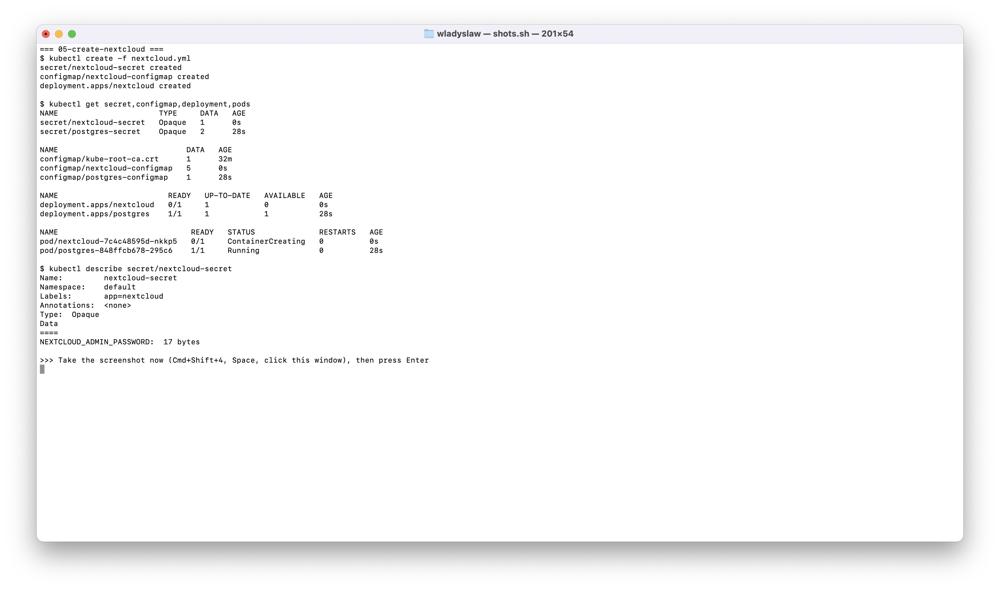

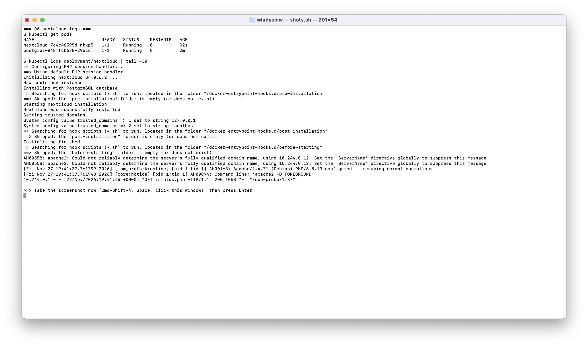

## Часть 3. Подключение извне

```bash
kubectl expose deployment nextcloud --type=NodePort --port=80
kubectl get service nextcloud
minikube service nextcloud         # открывает Nextcloud в браузере, держит терминал до Ctrl+C
```

Вход: логин `NEXTCLOUD_ADMIN_USER` из `nextcloud-configmap`, пароль `NEXTCLOUD_ADMIN_PASSWORD` из `nextcloud-secret`.

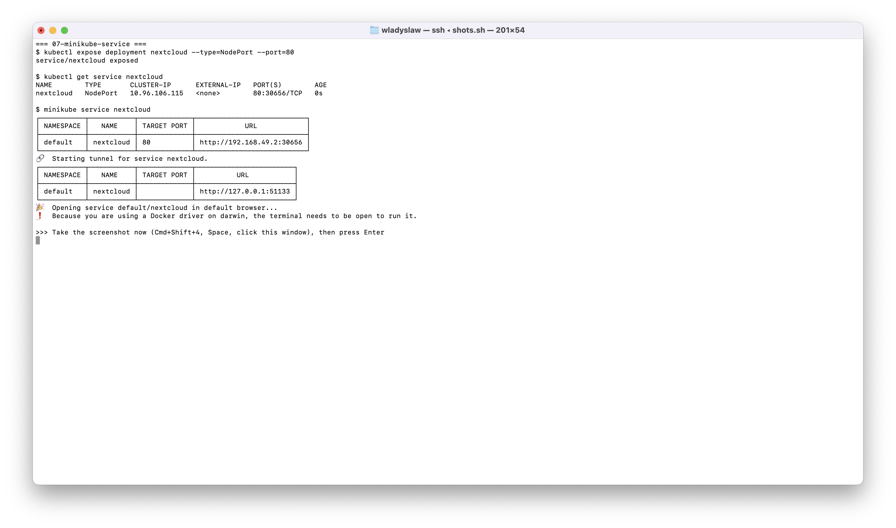

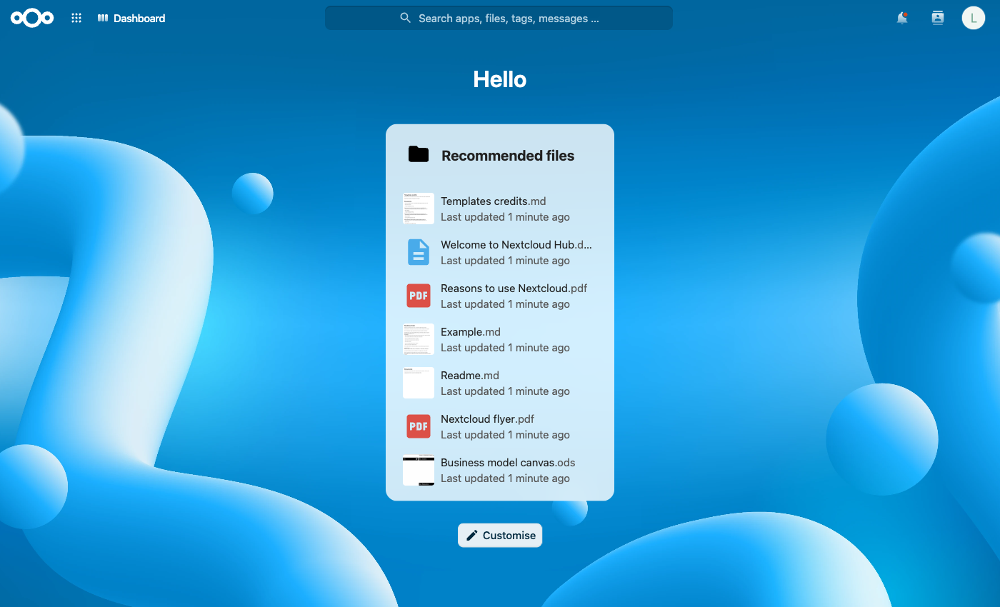

Dashboard:

```bash
minikube dashboard --url
```

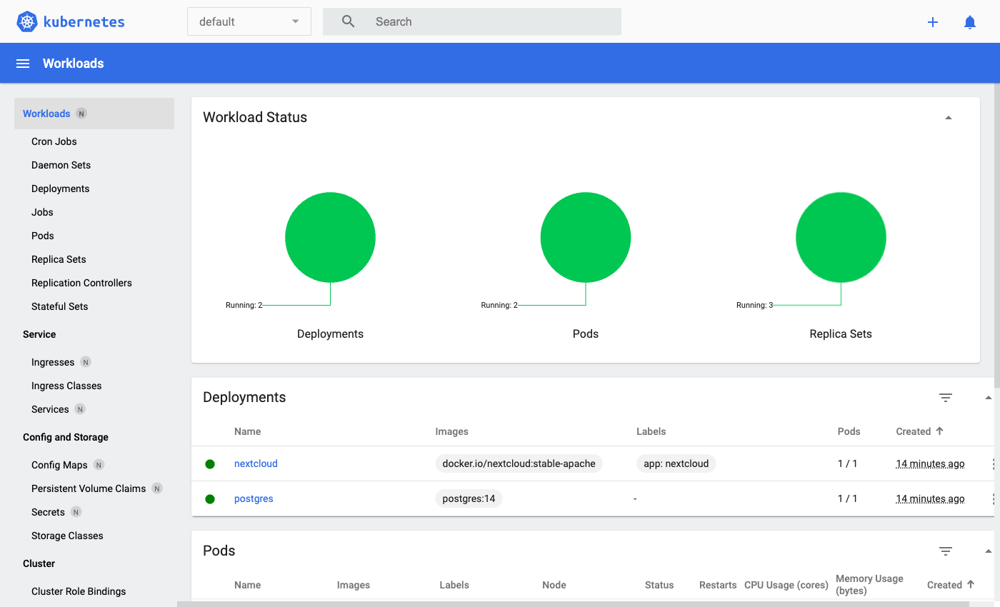

## Задание

| Требование | Что сделано |
|------------|-------------|
| `POSTGRES_USER` и `POSTGRES_PASSWORD` из ConfigMap в Secret | новый `pg_secret.yml` (Secret `postgres-secret`); в `pg_configmap.yml` остался только `POSTGRES_DB`; `pg_deployment.yml` подключает Secret через `envFrom.secretRef`; Nextcloud читает их через `secretKeyRef` вместо `configMapKeyRef` |
| Переменные Nextcloud из Deployment в ConfigMap | новый ConfigMap `nextcloud-configmap` в `nextcloud.yml`: `NEXTCLOUD_UPDATE`, `ALLOW_EMPTY_PASSWORD`, `POSTGRES_HOST`, `NEXTCLOUD_TRUSTED_DOMAINS`, `NEXTCLOUD_ADMIN_USER`. Deployment подключает его через `envFrom.configMapRef`, пароль администратора через `envFrom.secretRef` |
| Liveness и Readiness пробы для Nextcloud | `livenessProbe`: TCP на порт 80, жив ли Apache; `readinessProbe`: HTTP `GET /status.php` с заголовком `Host: localhost`, установлен ли Nextcloud и доступна ли база. Дополнительно `startupProbe` (до 10 минут), чтобы liveness не перезапускала контейнер во время первой установки |

Отдельно от задания у Nextcloud поднят лимит памяти с 256Mi до 1Gi. С 256Mi при первом входе в веб-интерфейс контейнер убивался по нехватке памяти (`OOMKilled`, код 137): Nextcloud в этот момент генерирует превью файлов. Перезапущенный контейнер пытался установиться заново в уже заполненную базу и падал с `permission denied for table oc_migrations`.

Две детали, без которых пробы не работают:

- kubelet шлёт HTTP-пробу на IP пода, а Nextcloud отвечает на неизвестный адрес `400 Trusted domain error`. Поэтому в пробе задан заголовок `Host: localhost`, а `localhost` добавлен в `NEXTCLOUD_TRUSTED_DOMAINS`.
- Apache в образе запускается только после окончания установки. Без startupProbe liveness проваливалась бы во время установки и перезапускала контейнер по кругу.

Проверка проб:

```bash
kubectl describe pod -l app=nextcloud     # блоки Liveness, Readiness, Startup и события проб
kubectl get pods -w                       # READY меняется 0/1 -> 1/1
```

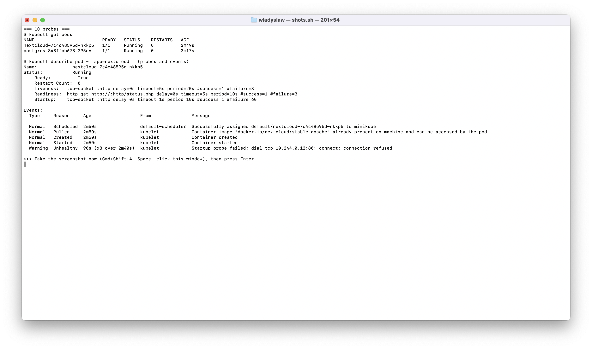

В событиях видно предупреждения `Startup probe failed: ... connection refused`: это первые минуты, пока Nextcloud устанавливался и Apache ещё не слушал порт 80. Перезапусков при этом не было (`RESTARTS 0`), под стал `READY 1/1`, как только установка закончилась.

## Ответы на вопросы

### Важен ли порядок выполнения манифестов? Почему?

Для конечного результата нет, для удобства и чистоты запуска да.

Kubernetes декларативный: каждый объект создаётся сам по себе, а контроллеры постоянно доводят кластер до описанного состояния. Поэтому при любом порядке всё в итоге заработает:

- Deployment создан раньше ConfigMap или Secret, на которые он ссылается: под получает статус `CreateContainerConfigError` (`configmap "postgres-configmap" not found`). Kubelet повторяет попытки и запускает контейнер, как только объект появится.
- Service создан позже Deployment: Service находит поды по `selector` в любой момент, порядок не важен.
- Nextcloud запущен раньше Postgres: образ Nextcloud пробует установиться 11 раз с паузой 10 секунд. Если база за это время не появилась, контейнер завершается с ошибкой, Kubernetes его перезапускает, и установка начинается заново.

Разумный порядок всё равно есть: ConfigMap и Secret, затем Service, затем Deployment, и Postgres раньше Nextcloud. Тогда нет промежуточных ошибок и перезапусков. Ещё одна причина ставить Service раньше: переменные окружения вида `POSTGRES_SERVICE_SERVICE_HOST` Kubernetes добавляет только в поды, созданные после Service. DNS-имя `postgres-service`, которое использует Nextcloud, работает при любом порядке.

### Что (и почему) произойдёт, если отскейлить количество реплик postgres-deployment в 0, затем обратно в 1, после чего попробовать снова зайти на Nextcloud?

```bash
kubectl scale deployment postgres --replicas=0
kubectl scale deployment postgres --replicas=1
```

Nextcloud перестанет работать. Проверено на кластере: через 30 секунд после возврата к 1 реплике под Nextcloud `0/1 Running` с 0 перезапусков (`Readiness probe failed: HTTP probe failed with statuscode: 500`), запрос через `minikube service` обрывается (`Connection reset by peer`, у Service нет готовых подов), а `/status.php` напрямую в поде отвечает 500.

Почему:

1. Scale до 0 удаляет под Postgres. Постоянного хранилища (PersistentVolume) у него нет, файлы базы лежали внутри контейнера и удалились вместе с ним.
2. Scale до 1 создаёт новый под с пустой базой. Образ postgres видит пустой каталог данных и заново создаёт базу `postgres` и пользователя из `postgres-secret`. Таблиц Nextcloud там нет.
3. Nextcloud же продолжает считать себя установленным: его настройки (`config.php`) хранятся в его собственном поде, который никто не трогал. При установке Nextcloud создал в базе своего служебного пользователя (здесь `oc_admin`) и записал его логин и пароль в `config.php`. В новой базе такого пользователя нет, и каждое обращение к базе заканчивается ошибкой `password authentication failed for user "oc_admin"` (вывод `php occ status` в поде).
4. `/status.php` отвечает 500, readinessProbe проваливается, и Service перестаёт отправлять запросы на под. livenessProbe проверяет только порт 80, поэтому контейнер не перезапускается: Apache жив, проблема в базе.

Как восстановить: `kubectl rollout restart deployment nextcloud`. Примерно через 2 минуты под снова `1/1`: новый под Nextcloud стартует с чистыми файлами, устанавливается в новую пустую базу заново, но все прежние данные (пользователи, файлы) потеряны. Чтобы такого не происходило, Postgres нужен PersistentVolumeClaim, смонтированный в `/var/lib/postgresql/data` (и Nextcloud тоже нужен свой, для `/var/www/html`).

## Очистка

```bash
kubectl delete -f nextcloud.yml -f pg_deployment.yml -f pg_service.yml -f pg_secret.yml -f pg_configmap.yml
kubectl delete service nextcloud
minikube stop        # остановить кластер, minikube delete удалит его целиком
```
