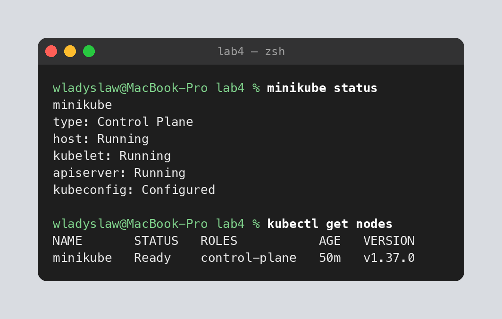
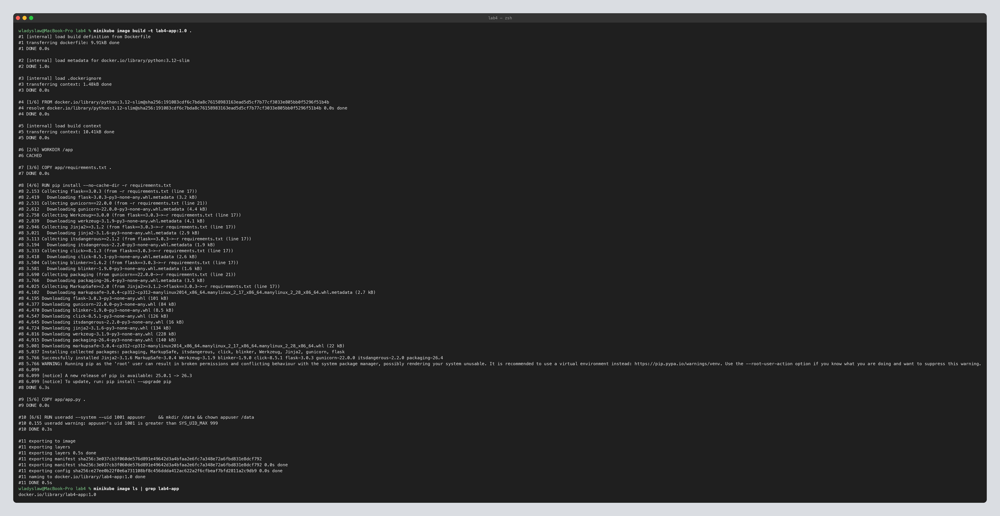
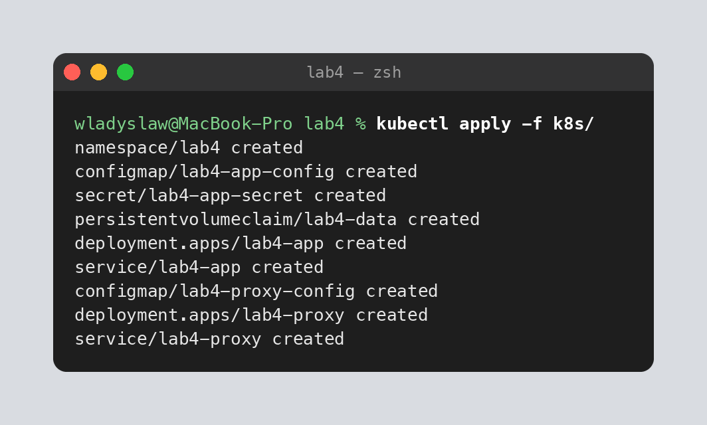
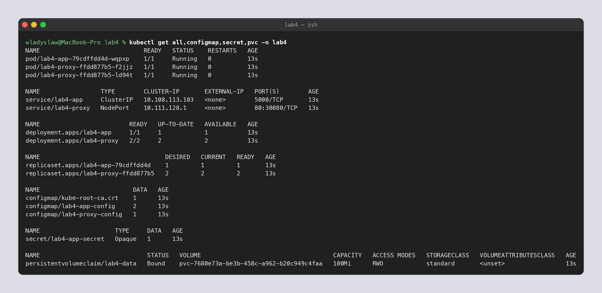
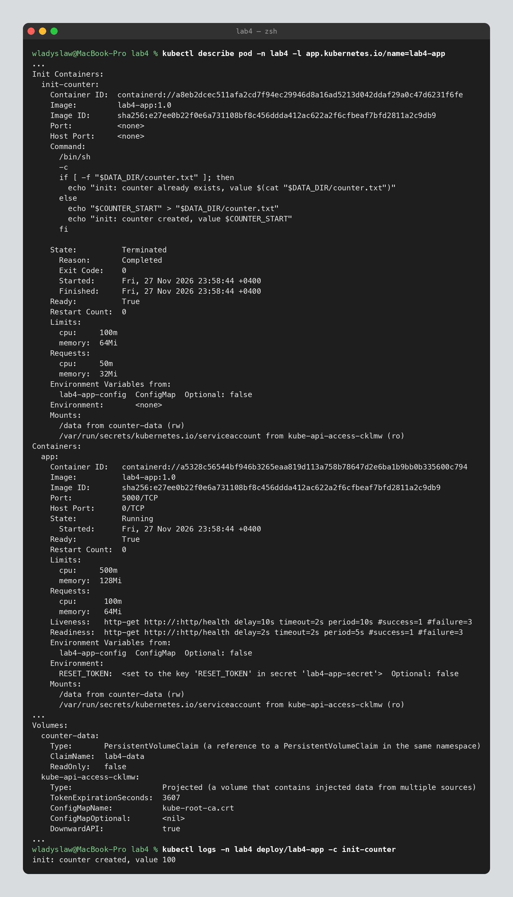
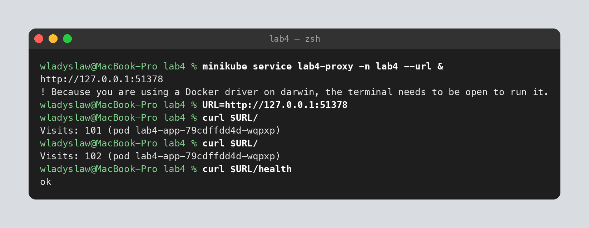
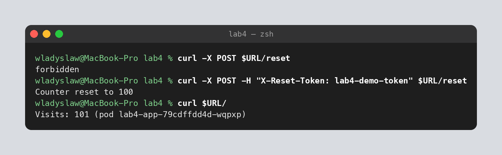
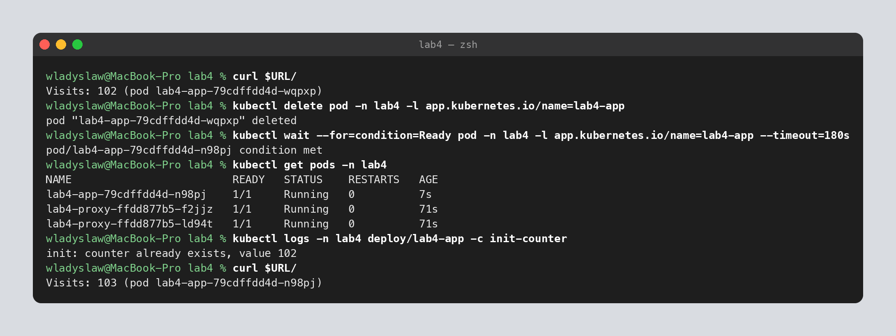
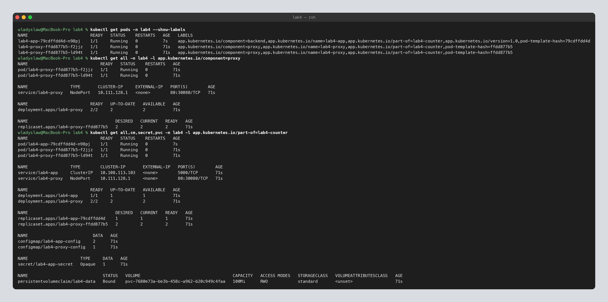
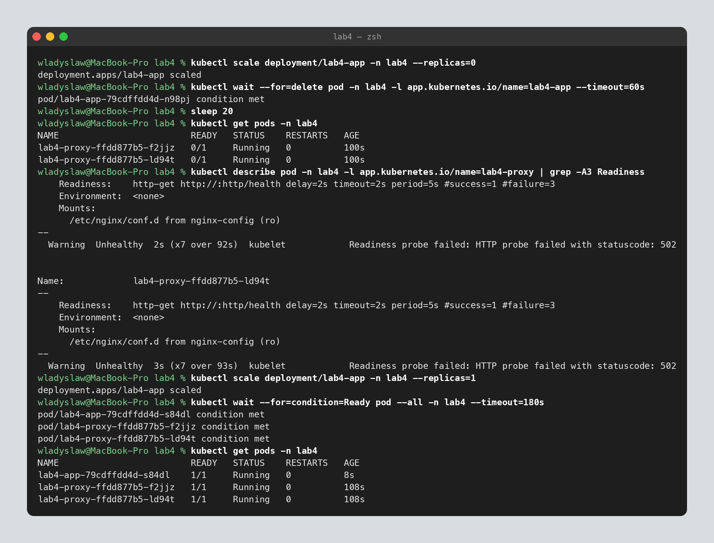

# ЛР 4. More Kubernetes

Сервис из ЛР 2 (счётчик посещений + nginx перед ним), перенесённый в Kubernetes. Два Deployment, собственный образ, init-контейнер, постоянный том, ConfigMap, Secret, два Service, пробы и метки. Кластер: Minikube из ЛР 3.

```
                 Minikube, namespace lab4
 ┌──────────────────────────────────────────────────────────────────────┐
 │                                                                      │
 │  Service lab4-proxy        Deployment lab4-proxy (2 пода)            │
 │  NodePort 30080  ───────►  nginx:1.27-alpine                         │
 │                            настройки из ConfigMap lab4-proxy-config  │
 │                                     │                                │
 │                                     ▼  http://lab4-app:5000          │
 │  Service lab4-app          Deployment lab4-app (1 под)               │
 │  ClusterIP 5000  ───────►  init-counter ──(завершился)──► app        │
 │                            образ lab4-app:1.0 (свой Dockerfile)      │
 │                            env из ConfigMap lab4-app-config          │
 │                            и Secret lab4-app-secret                  │
 │                                     │                                │
 │                                     ▼  /data                         │
 │                            PVC lab4-data (100Mi)                     │
 └──────────────────────────────────────────────────────────────────────┘
```

| Файл | Что это |
|------|---------|
| `Dockerfile`, `.dockerignore` | собственный образ `lab4-app:1.0` |
| `app/app.py`, `app/requirements.txt` | код приложения (из ЛР 2, добавлены `POST /reset` с токеном и имя пода в ответе) |
| `k8s/00-namespace.yaml` | namespace `lab4` |
| `k8s/10-configmap.yaml` | ConfigMap с настройками приложения: `DATA_DIR`, `COUNTER_START` |
| `k8s/20-secret.yaml` | Secret с `RESET_TOKEN` |
| `k8s/30-pvc.yaml` | PersistentVolumeClaim для файла счётчика |
| `k8s/40-app-deployment.yaml` | Deployment приложения: init-контейнер, контейнер, том, пробы |
| `k8s/50-app-service.yaml` | Service `lab4-app` (ClusterIP) |
| `k8s/60-proxy-configmap.yaml` | ConfigMap с файлом настроек nginx |
| `k8s/70-proxy-deployment.yaml` | Deployment nginx, 2 реплики, пробы |
| `k8s/80-proxy-service.yaml` | Service `lab4-proxy` (NodePort 30080) |

Каждый файл подробно прокомментирован внутри. Этот README: ход работы и сводка.

## Как выполнены требования

| Требование | Где |
|------------|-----|
| Минимум два Deployment | `lab4-app` (`40-app-deployment.yaml`) и `lab4-proxy` (`70-proxy-deployment.yaml`) |
| Кастомный образ из своего Dockerfile | `lab4-app:1.0`, собирается из `Dockerfile` командой `minikube image build`, используется в `lab4-app` |
| Deployment с контейнером и init-контейнером | `lab4-app`: `initContainers: init-counter` создаёт файл счётчика, затем стартует `containers: app` |
| Volume | `lab4-app`: PVC `lab4-data` в `/data` у обоих контейнеров; `lab4-proxy`: ConfigMap как том в `/etc/nginx/conf.d` |
| ConfigMap и Secret | `lab4-app-config` через `envFrom`, `lab4-proxy-config` как файл, `lab4-app-secret` через `secretKeyRef` |
| Service | `lab4-app` (ClusterIP, nginx обращается по имени `lab4-app:5000`) и `lab4-proxy` (NodePort 30080, вход снаружи) |
| Liveness и readiness пробы | обе в обоих Deployment. У nginx liveness на `/nginx-health` (сам nginx), readiness на `/health` (через nginx до приложения) |
| Лейблы помимо selector | у всех объектов `app.kubernetes.io/part-of`, `name`, `component`, у приложения ещё `version`. Используются в командах `kubectl get ... -l` ниже |

Дополнительно: у всех контейнеров заданы `resources.requests/limits`; приложение запускается не от root (`USER 1001` в Dockerfile, `runAsNonRoot` и `fsGroup` в манифесте); у `lab4-app` стратегия `Recreate`, потому что в файл на томе должен писать один под.

## Ход работы

Команды выполняются из папки `lab4/`. Под каждым шагом скриншот вывода из папки `screenshots/`. Окружение: macOS, minikube v1.39.0 (драйвер docker), Kubernetes v1.37.0.

### 1. Запустить Minikube

```bash
minikube start        # если кластер ещё не запущен
minikube status
kubectl get nodes
```

Все компоненты `Running`, узел `minikube` в статусе `Ready`.



### 2. Собрать собственный образ внутри Minikube

```bash
minikube image build -t lab4-app:1.0 .
minikube image ls | grep lab4-app
```

Образ собирается сразу в Minikube, поэтому кластер видит его без публикации на Docker Hub. В манифесте у него `imagePullPolicy: IfNotPresent`: взять образ с узла, а не скачивать.



### 3. Применить все манифесты

```bash
kubectl apply -f k8s/
```

Файлы пронумерованы, `kubectl` применяет их по алфавиту: сначала namespace, потом настройки и том, потом Deployment и Service.



### 4. Посмотреть, что создалось

```bash
kubectl get all,configmap,secret,pvc -n lab4
```

Ожидается: 1 под `lab4-app-...` и 2 пода `lab4-proxy-...` в `Running`, `READY 1/1`; Service `lab4-app` типа `ClusterIP` и `lab4-proxy` типа `NodePort` с `80:30080/TCP`; PVC `lab4-data` в статусе `Bound`.



### 5. Init-контейнер отработал

```bash
kubectl describe pod -n lab4 -l app.kubernetes.io/name=lab4-app
kubectl logs -n lab4 deploy/lab4-app -c init-counter
```

В `describe` в разделе `Init Containers` у `init-counter` состояние `Terminated`, `Reason: Completed`, `Exit Code: 0`. Там же видны том `counter-data` (PVC `lab4-data`), переменные из ConfigMap и Secret, пробы `Liveness` и `Readiness`. Лог: `init: counter created, value 100`.



### 6. Сервис работает

Открыть доступ к NodePort (на macOS команда держит туннель, запросы делать из второго окна терминала):

```bash
minikube service lab4-proxy -n lab4 --url
# напечатает адрес вида http://127.0.0.1:54321
```

Во втором окне, подставив свой адрес:

```bash
URL=http://127.0.0.1:54321
curl $URL/          # Visits: 101 (pod lab4-app-...)
curl $URL/          # Visits: 102 (pod lab4-app-...)
curl $URL/health    # ok
```

Запрос идёт `Service lab4-proxy → под nginx → Service lab4-app → под приложения`.



### 7. Secret: сброс счётчика по токену

```bash
curl -X POST $URL/reset                                       # forbidden
curl -X POST -H "X-Reset-Token: lab4-demo-token" $URL/reset   # Counter reset to 100
curl $URL/                                                    # Visits: 101
```

Без токена приложение отвечает 403. Токен приходит в контейнер из Secret `lab4-app-secret` как переменная `RESET_TOKEN`.



### 8. Данные переживают удаление пода

```bash
curl $URL/                                                    # запомнить N
kubectl delete pod -n lab4 -l app.kubernetes.io/name=lab4-app
kubectl wait --for=condition=Ready pod -n lab4 -l app.kubernetes.io/name=lab4-app --timeout=180s
kubectl get pods -n lab4                                      # новый под, другое имя
kubectl logs -n lab4 deploy/lab4-app -c init-counter          # init: counter already exists, value N
curl $URL/                                                    # Visits: N+1, имя пода другое
```

Deployment сам создал новый под взамен удалённого. Init-контейнер увидел, что файл уже есть, и не тронул его. Счётчик продолжился, потому что файл лежит на PVC, а не в контейнере.



### 9. Метки

```bash
kubectl get pods -n lab4 --show-labels
kubectl get all -n lab4 -l app.kubernetes.io/component=proxy
kubectl get all,cm,secret,pvc -n lab4 -l app.kubernetes.io/part-of=lab4-counter
```

Метки `component` и `part-of` в selector не участвуют, но позволяют выбрать объекты по роли или по системе целиком.



### 10. Readiness-проба в действии

Остановить приложение (0 подов) и посмотреть на nginx:

```bash
kubectl scale deployment/lab4-app -n lab4 --replicas=0
kubectl wait --for=delete pod -n lab4 -l app.kubernetes.io/name=lab4-app --timeout=60s
sleep 20                           # дать пробам nginx несколько раз провалиться
kubectl get pods -n lab4           # поды lab4-proxy: READY 0/1, RESTARTS 0
kubectl describe pod -n lab4 -l app.kubernetes.io/name=lab4-proxy | grep -A3 Readiness
kubectl scale deployment/lab4-app -n lab4 --replicas=1
kubectl wait --for=condition=Ready pod --all -n lab4 --timeout=180s
kubectl get pods -n lab4           # всё снова READY 1/1
```

`kubectl wait` ждёт, пока условие выполнится (под готов или удалён), и только потом возвращает управление. Это удобнее, чем следить за `kubectl get pods -w` и нажимать Ctrl+C.

Readiness nginx проверяет `/health` через приложение. Приложения нет, nginx отвечает 502 (в `describe` видно `Readiness probe failed: HTTP probe failed with statuscode: 502`), проверка проваливается, Service перестаёт слать запросы в nginx. Liveness nginx проверяет `/nginx-health`, на который nginx отвечает сам, поэтому контейнеры nginx не перезапускаются (`RESTARTS` остаётся 0): перезапуск nginx не починил бы отсутствующее приложение.



### 11. Удаление

```bash
kubectl delete namespace lab4
```

Удаляет все объекты работы, включая PVC с данными.
